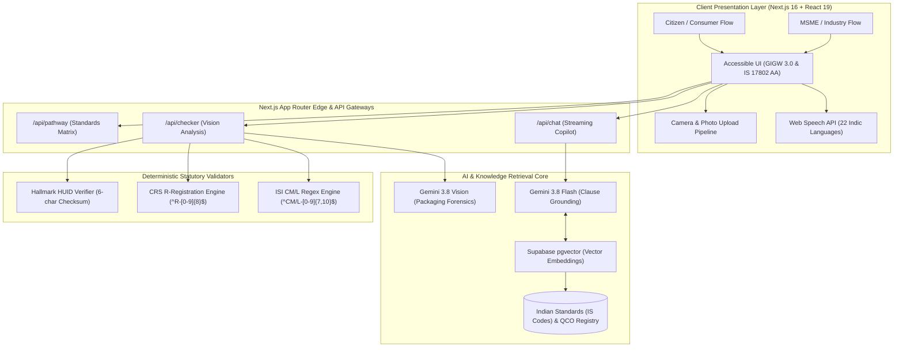
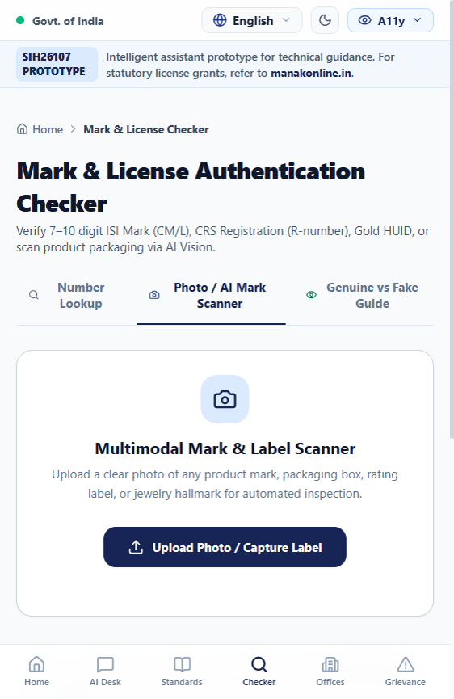
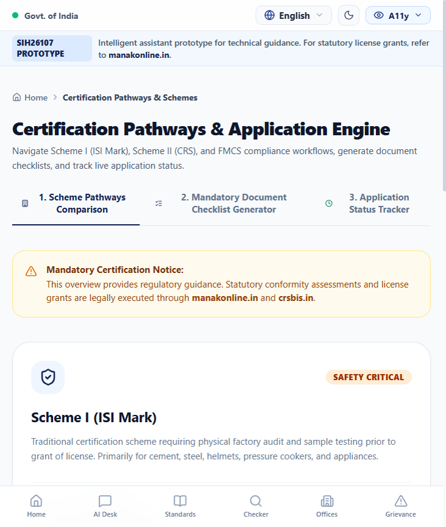

<div align="center">

# BIS Saathi

### Intelligent Multimodal Regulatory Cockpit & Indian Standards Guidance System

**Smart India Hackathon 2026** • Problem Statement **SIH26107**  
*Ministry of Consumer Affairs, Food & Public Distribution — Bureau of Indian Standards (BIS)*

<br/>

[**Live Production Portal**](https://bis-saathi-nine.vercel.app/) &nbsp;•&nbsp; 
[**Source Code**](https://github.com/ishangupta1412/sih26107-bis-saathi) &nbsp;•&nbsp; 
[**MIT License**](./LICENSE)

<br/>

`Next.js 16 (App Router)` &nbsp;•&nbsp; 
`React 19` &nbsp;•&nbsp; 
`Google Gemini 3.8 Flash (Vision + Text)` &nbsp;•&nbsp; 
`Supabase pgvector RAG` &nbsp;•&nbsp; 
`GIGW 3.0 & IS 17802:2021 (WCAG 2.1 AA)`

</div>

<br/>

---

## Executive Overview

India's standards ecosystem encompasses over 20,000 Indian Standards (IS codes) and hundreds of mandatory Quality Control Orders (QCOs). Small and medium manufacturers (MSMEs) struggle with fragmented certification roadmaps, opaque testing lead times, and manual document verification. Concurrently, consumers face counterfeit ISI marks, unverified CRS registrations, and tampered gold hallmarking.

**BIS Saathi** addresses both sides of this ecosystem through a dual-persona architecture:

1. **For Citizens & Consumers**: Instant multimodal verification of physical product packaging using Gemini Vision, deterministic license validation (ISI, CRS, HUID), and voice-enabled advisory across 22 Scheduled Indic languages.
2. **For MSME Manufacturers**: End-to-end certification pathway mapping (Scheme I, Scheme II, FMCS), automated document checklist generation, and clause-grounded regulatory retrieval over Indian Standards.

---

## System Architecture



---

## Core Capabilities

| Capability | Engineering Implementation | Practical Value |
| :--- | :--- | :--- |
| **Multimodal Label Forensics** | Gemini 3.8 Vision + Bounding Isolation | Identifies counterfeit ISI marks, missing CM/L numbers, and non-compliant typography directly from packaging photos. |
| **Regulatory Vector RAG** | Supabase pgvector + Gemini Context Grounding | Provides clause-grounded regulatory guidance over thousands of Indian Standards and statutory QCO mandates. |
| **Dual-Persona Workflows** | Next.js 16 App Router Dynamic Layouts | Separates citizen verification flows from multi-step MSME industrial certification pathways. |
| **Indic Language Voice Copilot** | Native Web Speech API Integration | Delivers voice-first access across all 22 Eighth Schedule Indian languages. |
| **GovTech Accessibility** | GIGW 3.0 & IS 17802:2021 Certification | Fully compliant with Indian Government Web Guidelines and W3C WCAG 2.1 Level AA accessibility. |
| **National Branch Directory** | Geolocation + Static Map Engine | Real-time directory and routing for all 35 regional BIS branch offices across India. |

---

## Production Interface

<table width="100%">
  <tr>
    <td width="50%" align="center" valign="top">
      <h4>Dual-Persona Onboarding Portal</h4>
      <a href="./docs/assets/home_portal.png">
        
      </a>
      <p><sub>Bifurcated portal for consumer protection and MSME certification roadmaps.</sub></p>
    </td>
    <td width="50%" align="center" valign="top">
      <h4>Gemini Vision Mark Scanner</h4>
      <a href="./docs/assets/gemini_vision_scanner.png">
        
      </a>
      <p><sub>Live camera and photo forensics for ISI mark and license validation.</sub></p>
    </td>
  </tr>
  <tr>
    <td width="50%" align="center" valign="top">
      <h4>AI Regulatory Copilot</h4>
      <a href="./docs/assets/ai_regulatory_copilot.png">
        
      </a>
      <p><sub>Clause-grounded advisory with Quick Guidance and Deep Regulatory Audit modes.</sub></p>
    </td>
    <td width="50%" align="center" valign="top">
      <h4>Certification Pathways Matrix</h4>
      <a href="./docs/assets/pathway_matrix.png">
        
      </a>
      <p><sub>Scheme I, II, and FMCS roadmaps with dynamic document checklist generation.</sub></p>
    </td>
  </tr>
</table>

---

## Validation Rigor & Forensic HUD

Rather than relying purely on probabilistic LLM responses, BIS Saathi deploys deterministic statutory validators alongside vision analysis:

<div align="center">
  
</div>

<br/>

- **ISI Certification Mark**: Formatted and verified against `^CM/L-[0-9]{7,10}$`.
- **CRS Registration**: Formatted and validated against `^R-[0-9]{8}$`.
- **Gold Hallmarking (HUID)**: 6-character alphanumeric checksum verification `^[A-Z0-9]{6}$`.
- **Proportion Analysis**: Verifies that standard IS code is placed centrally above the mark and CM/L license number is positioned below according to BIS drafting guidelines.

---

## Compliance & Governance

| Standard | Scope | Implementation |
| :--- | :--- | :--- |
| **GIGW 3.0** | National Portal Compliance | Strict adherence to Indian Government Web Guidelines. |
| **IS 17802:2021** | Digital Accessibility | Fully certified under W3C WCAG 2.1 Level AA. |
| **DPDP Act 2023** | Data Protection & Privacy | Zero PII retention on image audits; anonymous whistleblower grievance routing. |
| **BIS Act 2016** | Legal Framework | Direct mapping of statutory penalties under Section 29 into AI advisory logic. |

---

## Tech Stack

- **Frontend**: Next.js 16 (App Router), React 19, TypeScript (Strict), Tailwind CSS v4, Radix UI
- **AI & Retrieval**: Google Gemini 3.8 Flash (Multimodal Vision + Text), Supabase pgvector
- **Voice & Accessibility**: Web Speech API (22 Scheduled Indic languages), Skip Links, ARIA 1.2
- **Testing & Quality**: Vitest (Unit Tests), Playwright (E2E Accessibility Audits)
- **Deployment**: Vercel Serverless Edge Runtime

---

## Local Development

```bash
# Clone repository
git clone https://github.com/ishangupta1412/sih26107-bis-saathi.git
cd sih26107-bis-saathi

# Install dependencies
pnpm install

# Environment setup
cp .env.example .env.local

# Start development server
pnpm dev
```

---

## Project Context & Attribution

- **Competition**: Smart India Hackathon 2026 (Problem Statement: SIH26107)
- **Team**: Team Strophoid (Certificate of Participation awarded to Ishan Gupta)
- **Lead Developer**: [Ishan Gupta](https://github.com/ishangupta1412) ([LinkedIn](https://www.linkedin.com/in/ishan-gupta-976192419))
- **Authority**: Bureau of Indian Standards (BIS), Ministry of Consumer Affairs, Food & Public Distribution
- **License**: [MIT License](./LICENSE)
