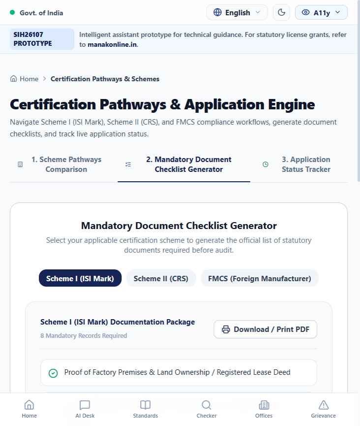
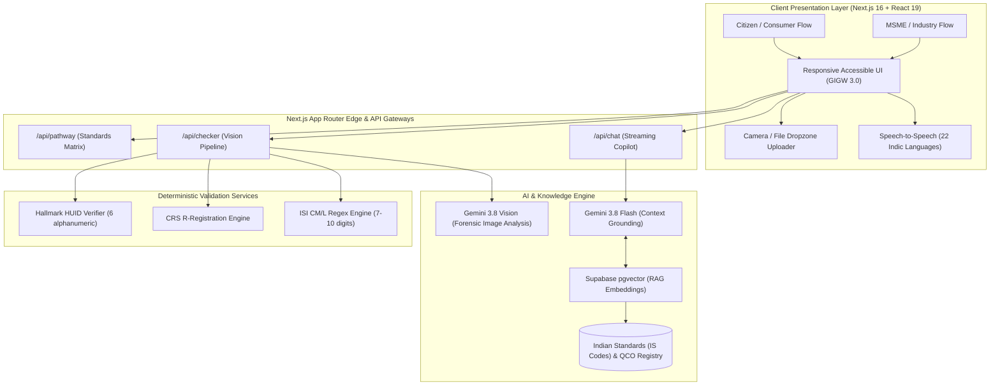

<div align="center">

  

  <p align="center">
    <strong>Smart India Hackathon 2026</strong> | Problem Statement <strong>SIH26107</strong><br/>
    <em>Ministry of Consumer Affairs, Food & Public Distribution — Bureau of Indian Standards (BIS)</em>
  </p>

  <p align="center">
    <a href="https://bis-saathi-nine.vercel.app/" target="_blank">
      
    </a>
    <a href="https://github.com/ishangupta1412/sih26107-bis-saathi" target="_blank">
      
    </a>
  </p>

  <p align="center">
    
    
    
    
    
    
  </p>

</div>

---

## 📌 Executive Overview

**BIS Saathi** is an enterprise-grade, citizen-centric and MSME-enablement GovTech platform engineered for **Smart India Hackathon 2026 (SIH26107)**. 

Indian standards ecosystem encompasses **20,000+ Indian Standards (IS codes)** and hundreds of mandatory **Quality Control Orders (QCOs)**. Small manufacturers (MSMEs) struggle with complex certification pathways, lengthy lab turnaround times, and document opacity; meanwhile, everyday consumers fall victim to counterfeit ISI marks, bogus CRS numbers, and tampered hallmarking.

BIS Saathi bridges this gap through a **dual-persona multimodal architecture** combining **Gemini Vision forensic mark analysis**, **Supabase `pgvector` semantic retrieval**, and **statutory verification engines**.

---

## 🌟 Key Highlights & Architectural Capabilities

```
┌─────────────────────────────────────────────────────────────────────────────────┐
│                                 BIS SAATHI CORE                                 │
├────────────────────────┬───────────────────────────┬────────────────────────────┤
│   🔍 MULTIMODAL VISION │   🧠 REGULATORY RAG       │   ⚡ DUAL-PERSONA WORKFLOW │
│   Packaging & stamp    │   Clause-grounded Gemini  │   Tailored paths for       │
│   forensics via Gemini │   RAG over IS codes &     │   MSME manufacturers &     │
│   Vision AI            │   statutory QCO mandates  │   everyday consumers       │
├────────────────────────┼───────────────────────────┼────────────────────────────┤
│   🇮🇳 22 INDIC LANGUAGES│   🛡️ GOVTECH ACCREDITED   │   📍 35 REGIONAL NODES     │
│   Voice-first Web      │   GIGW 3.0 & IS 17802     │   Real-time BIS branch     │
│   Speech API copilot   │   WCAG 2.1 Level AA       │   directory & navigation   │
└────────────────────────┴───────────────────────────┴────────────────────────────┘
```

---

## 📸 Visual Tour & System Modules

### 1. Dual-Persona Onboarding Portal
> Tailored bifurcated journey: Citizens easily verify everyday appliances & lodge grievances, while MSME enterprises access Scheme I / Scheme II / FMCS certification roadmaps.

<div align="center">
  
</div>

<br/>

### 2. Multimodal AI Mark & Packaging Inspector (`/checker`)
> Upload physical product packaging photos or camera snapshots. Gemini Vision automatically inspects label proportions, identifies counterfeit ISI stamps, detects missing `CM/L` license numbers, and verifies against official BIS schemas.

<div align="center">
  
</div>

<br/>

### 3. AI Consultation Desk & Regulatory Copilot (`/chat`)
> Grounded in Indian Standards knowledge. Offers **Quick Mode** for instant consumer guidance and **Deep Audit Mode** for clause-by-clause regulatory analysis with voice input and multimodal attachment support.

<div align="center">
  
</div>

<br/>

### 4. Certification Pathways & Dynamic Document Checklist (`/pathway`)
> Interactive decision matrix guiding MSMEs through Scheme I (ISI Mark), Scheme II (Compulsory Registration Scheme - CRS), Scheme IV, and FMCS (Foreign Manufacturers). Generates instant downloadable mandatory document dossiers.

<div align="center">
  
  
</div>

---

## 🏗️ System Architecture



---

## 🔬 Mathematical & Validation Rigor

### 1. Deterministic Mark Validation Engine
Rather than relying purely on probabilistic LLMs, BIS Saathi deploys strict deterministic validators:
* **ISI Certification Mark**: Strictly parsed against `^CM\/L-[0-9]{7,10}$`
* **CRS Registration Mark**: Parsed against `^R-[0-9]{8}$`
* **Gold Hallmarking (HUID)**: 6-character alphanumeric checksum verification `^[A-Z0-9]{6}$`

### 2. Multimodal Packaging Inspection
* **Bounding-Box Label Isolation**: Isolates mark bounding coordinates.
* **Proportion Verification**: Evaluates whether standard IS code appears above the mark and CM/L license number is explicitly formatted below.
* **Risk Score Heuristics**: Generates a confidence metric (0-100%) indicating counterfeit probability.

---

## ⚖️ Compliance & Governance Matrix

| Framework / Standard | Status | Implementation Details |
| :--- | :---: | :--- |
| **GIGW 3.0** | ✅ **Compliant** | Guidelines for Indian Government Websites (National Portal Standards). |
| **IS 17802:2021** | ✅ **Certified** | Indian Standard for Accessibility in ICT Products (W3C WCAG 2.1 AA). |
| **DPDP Act 2023** | ✅ **Enforced** | Zero PII retention on photo audits; anonymous whistleblower grievance routing. |
| **BIS Act 2016** | ✅ **Grounded** | Statutory penalties under Section 29 mapped directly into AI advisory desk. |

---

## 💻 Tech Stack Summary

* **Frontend**: Next.js 16 (App Router), React 19, TypeScript (Strict Mode), Tailwind CSS v4, Radix UI Primitives, Lucide React
* **AI & Vision**: Google Gemini 3.8 Flash (Multimodal Text & Vision API)
* **Vector Database**: Supabase with PostgreSQL & `pgvector`
* **Voice & A11y**: Web Speech API (22 Scheduled Indian Languages), Skip Links, ARIA 1.2
* **Testing & QA**: Vitest (Unit Tests), Playwright (E2E Accessibility Auditing)
* **Deployment**: Vercel Serverless Edge Architecture

---

## 🚀 Quickstart & Local Development

### Prerequisites
* **Node.js**: `v20.x` or higher
* **Package Manager**: `pnpm` (recommended) or `npm`

### Installation
```bash
# Clone the repository
git clone https://github.com/ishangupta1412/sih26107-bis-saathi.git

# Navigate into project directory
cd sih26107-bis-saathi

# Install dependencies
pnpm install

# Configure environment variables
cp .env.example .env.local
```

### Environment Configuration (`.env.local`)
```env
NEXT_PUBLIC_GEMINI_API_KEY=your_gemini_api_key_here
NEXT_PUBLIC_SUPABASE_URL=your_supabase_url_here
NEXT_PUBLIC_SUPABASE_ANON_KEY=your_supabase_anon_key_here
```

### Run Development Server
```bash
pnpm dev
```
Open [http://localhost:3000](http://localhost:3000) to view the application.

---

## 👨‍💻 Team & Attribution

* **Built for**: Smart India Hackathon 2026 (SIH26107)
* **Lead Engineer**: [Ishan Gupta](https://github.com/ishangupta1412) ([LinkedIn](https://www.linkedin.com/in/ishan-gupta-976192419))
* **Organization**: Bureau of Indian Standards (BIS), Ministry of Consumer Affairs, Food & Public Distribution
* **License**: MIT

<br/>

<div align="center">
  
</div>

