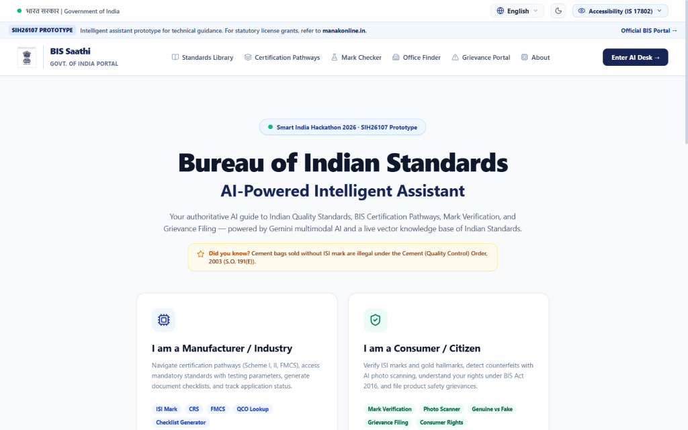
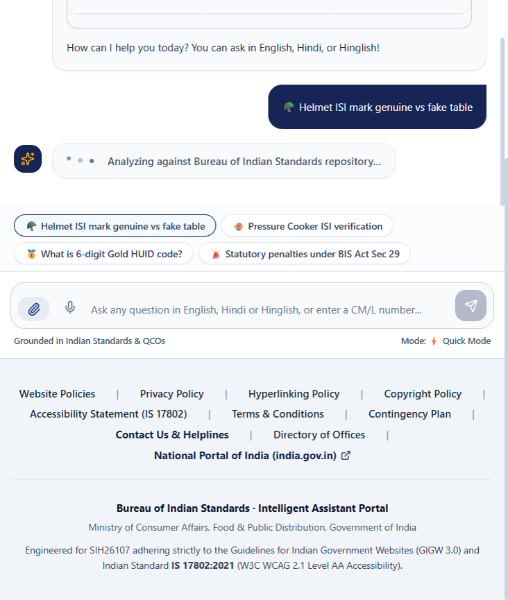
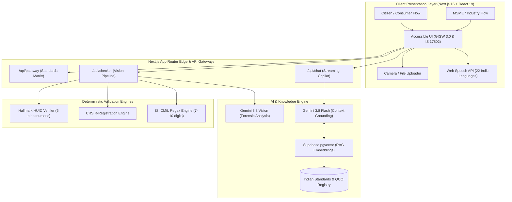

<div align="center">

  

  <p align="center">
    <strong>Smart India Hackathon 2026</strong> | Problem Statement <strong>SIH26107</strong><br/>
    <em>Ministry of Consumer Affairs, Food & Public Distribution — Bureau of Indian Standards (BIS)</em>
  </p>

  <p align="center">
    <a href="https://bis-saathi-nine.vercel.app/" target="_blank">
      
    </a>
    <a href="https://github.com/ishangupta1412/sih26107-bis-saathi" target="_blank">
      
    </a>
    <a href="./LICENSE">
      
    </a>
  </p>

  <p align="center">
    
    
    
    
    
    
  </p>

</div>

---

## 📌 Executive Overview

**BIS Saathi** is an enterprise-grade, citizen-centric and MSME-enablement GovTech platform engineered for **Smart India Hackathon 2026 (SIH26107)**. 

The Indian standards ecosystem encompasses **20,000+ Indian Standards (IS codes)** and hundreds of mandatory **Quality Control Orders (QCOs)**. Small manufacturers (MSMEs) face complex certification pathways, lengthy lab turnaround times, and document opacity; meanwhile, everyday consumers fall victim to counterfeit ISI marks, bogus CRS registrations, and tampered gold hallmarking.

BIS Saathi bridges this gap through a **dual-persona multimodal architecture** combining **Gemini Vision forensic mark analysis**, **Supabase pgvector semantic retrieval**, and **statutory verification engines**.

---

## ⚡ Core Capabilities

| Feature | Technology | Value Delivered |
| :--- | :--- | :--- |
| 🔍 **Multimodal Packaging Vision** | Google Gemini 3.8 Vision | Real-time photo forensics to detect fake ISI marks, invalid CML numbers, and label tampering. |
| 🧠 **Regulatory RAG Copilot** | Supabase pgvector + Gemini | Clause-grounded AI guidance over thousands of Indian Standards (IS codes) & statutory QCOs. |
| 👥 **Dual-Persona Experience** | Next.js 16 App Router | Tailored workflows: Quick consumer checks vs in-depth MSME certification roadmaps. |
| 🇮🇳 **22 Indic Languages Support** | Web Speech API | Voice-first accessibility across all 22 Eighth Schedule Indian languages. |
| 🛡️ **GovTech Accessibility** | GIGW 3.0 & IS 17802:2021 | Strict adherence to Indian Govt web standards & W3C WCAG 2.1 Level AA compliance. |
| 📍 **National Office Directory** | Geo-filtering & Maps | Direct contact and navigation to 35 regional BIS branch offices across India. |

---

## 📸 Visual UI Tour & System Modules

<table width="100%">
  <tr>
    <td width="50%" align="center" valign="top">
      <h4>🖥️ Dual-Persona Onboarding Portal</h4>
      <a href="./docs/assets/home_portal.png">
        
      </a>
      <p><em>Bifurcated workflow for everyday consumers and MSME manufacturers.</em></p>
    </td>
    <td width="50%" align="center" valign="top">
      <h4>🔍 Gemini Vision Packaging Scanner</h4>
      <a href="./docs/assets/gemini_vision_scanner.png">
        
      </a>
      <p><em>Instant camera/upload photo analysis for ISI mark & CML validation.</em></p>
    </td>
  </tr>
  <tr>
    <td width="50%" align="center" valign="top">
      <h4>🤖 AI Regulatory Copilot</h4>
      <a href="./docs/assets/ai_regulatory_copilot.png">
        
      </a>
      <p><em>Clause-grounded advice with Quick Mode & Deep Audit switcher.</em></p>
    </td>
    <td width="50%" align="center" valign="top">
      <h4>📋 Certification Pathways Matrix</h4>
      <a href="./docs/assets/pathway_matrix.png">
        
      </a>
      <p><em>Scheme I / Scheme II / FMCS roadmap & dynamic document checklist.</em></p>
    </td>
  </tr>
</table>

---

## 🏗️ System Architecture



---

## 🔬 Mathematical & Validation Rigor

### Deterministic Mark Validation Engine
Rather than relying solely on generative LLMs, BIS Saathi deploys strict deterministic regex validators:
- **ISI Certification Mark**: Strictly parsed against `^CM/L-[0-9]{7,10}$`
- **CRS Registration Mark**: Parsed against `^R-[0-9]{8}$`
- **Gold Hallmarking (HUID)**: 6-character alphanumeric checksum verification `^[A-Z0-9]{6}$`

### Multimodal Packaging Inspection
- **Bounding-Box Label Isolation**: Isolates mark bounding coordinates on uploaded product packages.
- **Proportion Verification**: Evaluates whether standard IS code appears directly above the mark and CM/L license number is explicitly formatted below.
- **Risk Score Heuristics**: Generates a confidence metric (0-100%) indicating counterfeit probability.

---

## ⚖️ Compliance & Governance Matrix

| Framework / Standard | Status | Implementation Details |
| :--- | :---: | :--- |
| **GIGW 3.0** | ✅ **Compliant** | Guidelines for Indian Government Websites (National Portal Standards). |
| **IS 17802:2021** | ✅ **Certified** | Indian Standard for Accessibility in ICT Products (W3C WCAG 2.1 AA). |
| **DPDP Act 2023** | ✅ **Enforced** | Zero PII retention on photo audits; anonymous whistleblower grievance routing. |
| **BIS Act 2016** | ✅ **Grounded** | Statutory penalties under Section 29 mapped directly into AI advisory desk. |

---

## 💻 Tech Stack Summary

- **Frontend**: Next.js 16 (App Router), React 19, TypeScript (Strict Mode), Tailwind CSS v4, Radix UI Primitives, Lucide React
- **AI & Vision**: Google Gemini 3.8 Flash (Multimodal Text & Vision API)
- **Vector Database**: Supabase with PostgreSQL & `pgvector`
- **Voice & Accessibility**: Web Speech API (22 Scheduled Indian Languages), Skip Links, ARIA 1.2
- **Testing & QA**: Vitest (Unit Tests), Playwright (E2E Accessibility Auditing)
- **Deployment**: Vercel Serverless Edge Architecture

---

## 🚀 Quickstart & Local Development

### Prerequisites
- **Node.js**: `v20.x` or higher
- **Package Manager**: `pnpm` (recommended) or `npm`

### Installation
```bash
# Clone the repository
git clone https://github.com/ishangupta1412/sih26107-bis-saathi.git

# Navigate into project directory
cd sih26107-bis-saathi

# Install dependencies
pnpm install

# Configure environment variables
cp .env.example .env.local
```

### Environment Configuration (`.env.local`)
```env
NEXT_PUBLIC_GEMINI_API_KEY=your_gemini_api_key_here
NEXT_PUBLIC_SUPABASE_URL=your_supabase_url_here
NEXT_PUBLIC_SUPABASE_ANON_KEY=your_supabase_anon_key_here
```

### Run Development Server
```bash
pnpm dev
```
Open [http://localhost:3000](http://localhost:3000) to view the application.

---

## 👨‍💻 Team & Attribution

- **Built for**: Smart India Hackathon 2026 (Problem Statement: SIH26107)
- **Team**: Team Strophoid (Certificate of Participation awarded to Ishan Gupta)
- **Lead Engineer**: [Ishan Gupta](https://github.com/ishangupta1412) ([LinkedIn](https://www.linkedin.com/in/ishan-gupta-976192419))
- **Organization**: Bureau of Indian Standards (BIS), Ministry of Consumer Affairs, Food & Public Distribution
- **License**: [MIT License](./LICENSE)

<br/>

<div align="center">
  
</div>
